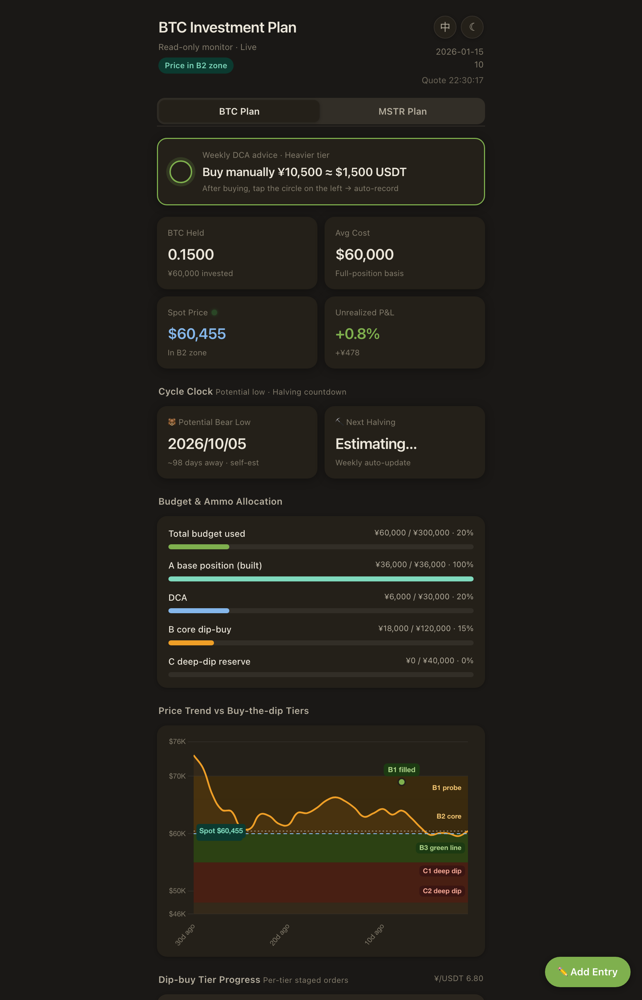

# invest-cockpit

A personal **investment cockpit** for a dollar-cost-averaging (DCA) + dip-buying strategy across **BTC** and **MSTR**. It pairs a read-only mobile web dashboard with a conversational Telegram bookkeeping layer, so positions, ladder plans and on-chain signals are always one glance (or one message) away.

> This is a sanitized, English, public showcase build. All holdings, budgets and fills in `seeds/` are **fictional demo data** — the production ledger lives server-side and is never committed.

<p align="center">
  
</p>

<p align="center"><sub>The dashboard with demo data. UI language is switchable (English / 中文) via the toggle in the top bar.</sub></p>

## Highlights

- **Bilingual H5 dashboard (English / 中文)** — a single-file, framework-free responsive web cockpit. Language is switchable at runtime (defaults to English) and persisted in `localStorage`; light/dark theme included.
- **Two-factor, stateless auth** — dashboard access uses an HMAC static identity token **plus** a time-boxed signed code (`dash_link.py`). No server-side session store; revocation = rotate the secret. Auth failures return a plain `404` so the dashboard's existence isn't leaked.
- **Single write-entry ledger** — every mutation (web `POST`, Telegram, cron) funnels through one deterministic script; the web layer never touches the ledger file directly. File locking guards concurrent writers.
- **Pure-function strategy engines** — `strategy.py` / `strategy_mstr.py` compute weekly DCA pacing and dip-ladder advice as pure functions with no network/IO, so they are fully unit-testable offline.
- **Dynamic, anchored dip ladders** — dip-buy tiers re-anchor to live on-chain indicators (200-week MA, realized price, "green line"), with frozen-tier drift detection to avoid moving the goalposts.
- **mNAV tracking for MSTR** — modeled NAV premium/discount (diluted, no-debt caliber) drives MSTR entry triggers, backfilled from a holdings timeline.
- **Deploy with a test gate** — the deploy path runs the full test suite as a hard gate before shipping; the production ledger is protected by three independent safeguards (gitignore + deploy allowlist + pre/post checksum).

## Layout

```
app/        Web layer: app.py (Flask, read-only API) · dashboard.html (bilingual H5)
            Strategy engines: strategy.py · strategy_mstr.py · mnav.py (single source of truth)
            Signals/alerts: tier_alert.py · frozen_tiers.py · onchain_signals.py (+ cron drivers)
skills/     Conversational layer: btc-tracker / mstr-tracker (Telegram bot skills)
seeds/      Demo ledger seeds (preview & tests only — never a real ledger)
deploy/     Deploy entrypoints + snapshot/rollback + redaction tests
run-tests.sh  Single test entrypoint (also the pre-deploy gate)
```

## Quick start

```bash
python3 -m venv .venv && .venv/bin/pip install -r requirements.txt -r requirements-dev.txt
source .venv/bin/activate

# Run the full test suite
./run-tests.sh

# Preview the dashboard locally with demo data
DASHBOARD_SECRET=dev \
  BTC_STATE=$PWD/seeds/state.seed.json \
  MSTR_STATE=$PWD/seeds/mstr-state.seed.json \
  python app/app.py
# then open the signed dashboard link printed by:  python app/app.py --link
```

## Architecture at a glance

```
   Telegram  ──▶  bot skills (DeepSeek)  ──┐
                                            ├─▶  single write-entry script  ──▶  ledger (state.json)
   Web POST  ──▶  Flask (2FA)  ────────────┘                                          │
                                                                                      ▼
   Browser  ──▶  Flask read API (2FA)  ──▶  strategy engines + live quotes  ──▶  H5 dashboard
   cron      ──▶  tier/drift alerts  ──▶  Telegram notifications
```

The conversational layer is driven by an LLM (DeepSeek in production); its skill prompts live under `skills/*/SKILL.md`. The dashboard and strategy engines are provider-agnostic.

## Testing

`./run-tests.sh` runs every module's test as a standalone script under a single `PYTHONPATH`, covering the strategy engines, auth, write routes, on-chain signal parsing, tier anchoring/drift, mNAV series, and the server snapshot/redaction logic.

## Tech

Python 3 · Flask · vanilla JS/HTML/CSS (no frontend framework) · HMAC-SHA256 auth · public market data (Binance, on-chain indicators) — no exchange API keys required.
</content>
